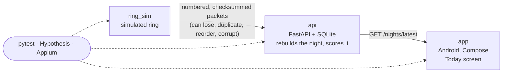
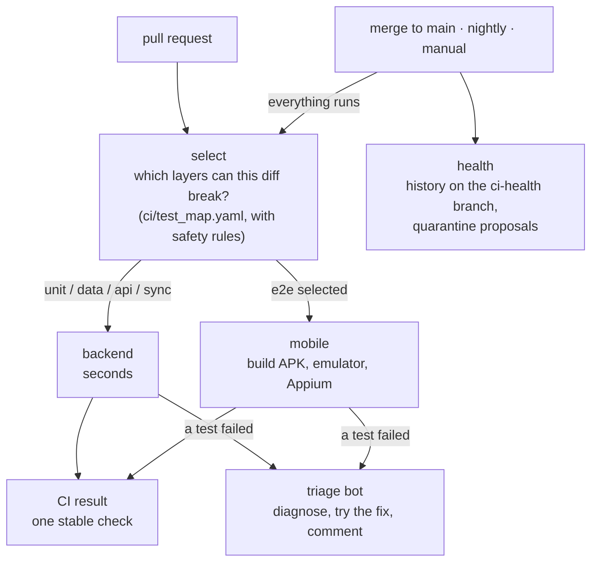

# RingPulse

A small smart-ring system and the test system built around it. The product is a toy; **the testing is the point**: every hop between the ring, the cloud and the phone has tests, the CI picks only the tests a change can break, flaky tests are tracked and contained, and a bot diagnoses failures.



No real Bluetooth: an emulator has none, so the app pulls from the API and the simulator plays the ring on the other side. With real test rings the interesting changes would be pairing, firmware versions and radio conditions; the packet and sync-fault tests are where that would plug in.

## What is tested, and how

Every test carries a layer marker (enforced at collection time), so CI and humans can run one layer at a time.

| Layer | Tests | What it checks | Tools |
|---|---|---|---|
| `unit` | 132 | Scoring rules, packet parsing and checksums, properties such as "scores never leave 0–100" and "more sleep never lowers the sleep score", plus the CI and triage tooling itself | pytest, Hypothesis |
| `data` | 10 | Four named nights ("golden nights") score within tolerance of expected values; a new readiness formula stays within 5 points of the old one | pytest |
| `api` | 37 | The sync endpoint over HTTP: duplicates, bad checksums, conflicts, gaps, restart persistence | FastAPI TestClient |
| `sync` | 30 | The ring simulator against the API with injected faults: loss, duplicates, reordering, corruption, disconnects. Whatever goes wrong, a clean retry converges to the same night | pytest, Hypothesis |
| `e2e` | 6 | The real app on an Android emulator against the real API: scores, sync badge, partial sync, API outage | Appium, page objects |

Why the sync layer matters: the protocol has sequence numbers and checksums on purpose, so gap detection and de-duplication are testable in miniature (the same ideas as message-stream testing in larger systems). Two other deliberate seams: a readiness-formula **feature flag** (compare old vs new within tolerance, the way an algorithm change would be validated) and a fixed set of **golden nights** shared by every layer.

[docs/test-plan.md](docs/test-plan.md) has scope, twelve risks mapped to layers, environments, and entry/exit criteria. Open findings are in [docs/known-issues.md](docs/known-issues.md).

## The pipeline



- **Smart selection.** A plain Python selector maps changed files to layers from a readable map. A docs-only change runs nothing; a change in `app/` runs only the emulator layer. Anything it does not know, shared plumbing, or any run that is not a pull request runs **everything**, so the shortcut cannot let a miss into `main`. Every run prints a "file → layers → why" table. See [docs/ci.md](docs/ci.md).
- **Flaky tests.** A failed test is retried once in CI; a pass on retry is recorded as *flaky*, never as a clean pass. Tests that keep flaking are proposed for quarantine (still run, no longer block); tests that fail every time are never quarantined, because they are broken, not flaky. See [docs/flaky-tests.md](docs/flaky-tests.md).
- **Failure triage bot.** When a test fails on a pull request, the bot decides who is wrong (the test or the app), proposes a patch, **applies it in a scratch copy and re-runs the failed test**, and posts one comment. It never pushes or merges. See [docs/triage.md](docs/triage.md).

An excerpt of a real comment, on a pull request described only as "Refactor sleep minutes calculation" that quietly changed `len(asleep)` to `len(asleep) - 1` (a seeded bug):

````text
tests/unit/test_scoring.py::test_full_night_at_baseline

app_regression (model diagnosis). The PR, described only as a cleanup refactor, changed
sleep_minutes to (len(asleep) - 1) * SAMPLE_INTERVAL_MIN, which undercounts one sample
interval (5 min). 96 samples of 5 minutes should be 480 minutes, and the test comment
confirms this.

Evidence:
  sleep_minutes=(len(asleep) - 1) * SAMPLE_INTERVAL_MIN,
  assert 475 == 480

Fix check: fix verified (. [100%] 1 passed in 0.53s)

-        sleep_minutes=(len(asleep) - 1) * SAMPLE_INTERVAL_MIN,
+        sleep_minutes=len(asleep) * SAMPLE_INTERVAL_MIN,
````

That is one run on one seeded bug, not an accuracy figure. The bot is built so it can be measured (versioned prompt and schema, one JSON answer per failure), but no benchmark has been run yet.

## What running it in CI taught

The emulator job failed on roughly one run in three on identical code. Every emulator test failed in setup, waiting for the Today screen, and retries did not help. The cause was only visible once the harness saved the emulator's own screenshot on setup failures (it had saved evidence only for failures inside a test body): *"Pixel Launcher isn't responding"*, a system dialog covering the app on a slow CI emulator. The fix was in the harness (press **Wait**, bring the app back) plus a lighter system image, and the suite now logs whenever the device needed that help. Details in [docs/e2e-tests.md](docs/e2e-tests.md).

## Run it

```bash
pip install -r requirements-dev.txt
pytest                         # everything that can run here (emulator tests skip without a setup)
pytest -m unit                 # one layer: unit, data, api, sync, e2e

python -m ring_sim generate                   # regenerate fixtures/nights/*.json (deterministic)
python -m ring_sim sync good_night            # sync a fixture night to a running API (--drop 3,5 loses packets)

docker compose up --build                     # the API on :8000
curl localhost:8000/health

python -m ci.select_tests --files api/scoring.py README.md    # what would CI run for this change?
```

The emulator tests need an emulator, an Appium server and the debug APK: [docs/e2e-tests.md](docs/e2e-tests.md). The app is described in [docs/android-app.md](docs/android-app.md).

Readiness has a feature flag: `RINGPULSE_READINESS_FORMULA=v2` switches to the new weights.

## Repository map

| Path | What it is |
|---|---|
| `ring_sim/` | The simulated ring: generates a night, sends packets, injects faults |
| `api/` | FastAPI + SQLite: packet validation, night reconstruction, scoring |
| `app/` | Android app (Kotlin, Compose): scores, sync badge, Sync now button |
| `fixtures/nights/` | Named nights shared by every layer: `good_night`, `short_night`, `restless_night`, `missing_data` |
| `tests/` | One folder per layer, plus tests for the CI and triage tooling |
| `ci/` | Test selector and map, test-results plugin (reruns, quarantine), health history |
| `triage/` | The failure triage bot |
| `.github/workflows/ci.yml` | The pipeline |

## Sync protocol

`POST /sync` with `{device_id, night_id, total_packets, packets: [{seq, samples, checksum}]}`.

- A packet seen twice is ignored (`duplicates`); one with a bad checksum is rejected.
- Packets may arrive in any order; the night is rebuilt by `seq`.
- Missing sequence numbers give `sync_status: partial` and are listed in `missing_packets`. Sending the missing packets later completes the night.

`GET /nights/{night_id}` returns the sync status plus `sleep_score` and `readiness_score`. `GET /nights/latest` returns the same for the night that most recently received a packet; the app's Today screen uses it.

## Honest limits

- The Android app is a thin template on purpose; the device layer and tests are the work.
- Emulator only: no real phones or rings yet. A nightly run on a device farm is the natural next step.
- Triage patches for emulator tests are diagnosed but not verified (the triage job has no emulator).
- The triage bot authenticates with a static API key kept as a repository secret, on a workspace with a spend limit; short-lived federated credentials would be the production choice.
- Two decisions are still open and recorded as findings: what an unknown readiness flag value should do (KI-1) and whether partial nights should be scored at all (KI-2).
