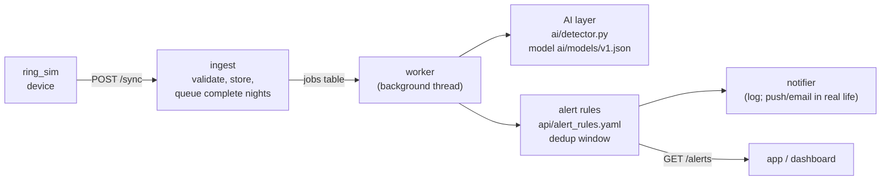

# AI layer and alerts

RingPulse now has the full device-to-cloud shape: **device → ingest → AI layer → alert rules → app**.
The model and the rules are deliberately tiny. The point is how each piece is tested, not how clever it is.



## The pieces

| Piece | File | What it does |
|---|---|---|
| Queue | `api/worker.py`, `jobs` table | `/sync` queues a night once, when that sync completes it. A repeat sync accepts nothing, so it queues nothing. |
| Worker | `api/worker.py` | Background thread: picks pending jobs, runs the detector, stores the analysis, applies the rules, delivers new alerts after the database commit. A failing night is marked `failed` and does not stop the queue. Also checks for silent devices. |
| Features | `ai/features.py` | Resting HR, HRV and temperature against the user's baseline, share of restless samples. A dead sensor gives `None`, not zero. |
| Model | `ai/detector.py`, `ai/models/*.json` | A logistic score over the features. The weights file is the model artifact: it can change behaviour without any code change. Active version: `RINGPULSE_MODEL` (default `v1`), checked when the app starts. |
| Eval set | `ai/evalset.py` | 150 labelled nights from the simulator in five slices: calm, restless (hard negatives), ill, mild_ill (hard positives), hrv_dropout (ill nights with a dead HRV sensor). Generated deterministically from case ids, so the file is the version. |
| Gate | `ai/evaluate.py` | Recall per slice must not drop more than 0.05 below the current model, false alarms per slice must not rise more than 0.05, overall recall must stay above 0.85. |
| Rules | `api/alert_rules.yaml`, `api/alerts.py` | `illness_signs` (detection with confidence ≥ 0.8), `low_readiness` (< 60), `device_silent` (no sync for 36 h). The same rule for the same device fires once per 24 h; repeats raise a counter. |
| Endpoints | `api/main.py` | `GET /nights/{id}/analysis` (202 while queued or partial, 200 when done), `GET /alerts?device_id=…` (one device's alerts only). |

## How each layer is tested

| What | Tests | How |
|---|---|---|
| Code around the model | `tests/unit/test_detector.py` | Ordinary unit tests: features of a baseline night are zero, a dead HRV sensor is `None`, unknown version fails with the known ones listed. Hypothesis: confidence is always 0–1; a higher resting HR never lowers confidence (a metamorphic property, no labels needed). |
| Model quality | `tests/data/test_model_gate.py` | Statistical, against thresholds, on the eval set. Never mixed into functional tests, which would make them flaky. |
| Alert rules | `tests/unit/test_alert_rules.py` | Tables: input → expected alerts, both sides of every threshold, dedup inside and outside the window, never across devices. Frozen clock, in-memory database. |
| The pipeline | `tests/api/test_processing.py` | Through the API with a hand-moved clock and a recording notifier; the worker's step is run directly, so the tests are deterministic. One test runs the real background thread and waits **by condition** (`wait_until`), never by `sleep`. It passed 30 runs out of 30 before merge. |

## The model gate, shown

```bash
python -m ai.evaluate --candidate v2 --baseline v1
```

```text
| Slice | Measures | Cases | v1 | v2 |
|---|---|---|---|---|
| calm | false alarms | 30 | 0.00 | 0.00 |
| restless | false alarms | 30 | 0.00 | 0.03 |
| ill | recall | 30 | 1.00 | 1.00 |
| mild_ill | recall | 30 | 0.77 | 0.97 |
| hrv_dropout | recall | 30 | 1.00 | 0.87 |
| **all ill nights** | recall | | 0.92 | 0.94 |

GATE FAILED: v2 must not replace v1
  - hrv_dropout: recall fell from 1.00 to 0.87
```

v2 is better on average: it catches many more mild cases. But it fills a missing HRV value with the
healthy-population average, so a sick user whose HRV sensor died looks healthy. Only the per-slice
check sees it. `v3` is v2 with the imputation fixed, and it passes:

```bash
python -m ai.evaluate --candidate v3 --baseline v1   # GATE PASSED
```

## What a real system would add

- A real model trained on labelled recordings, with the eval set versioned in an artifact store, not generated.
- Shadow mode: a new model runs on live data next to the current one without raising alerts, and the two are compared before a canary rollout.
- Drift monitoring: input distributions and alert rates per customer, with an alert when they shift.
- A real queue (Kafka, SQS) and real notification channels behind the same `Notifier` interface.
- A synthetic device in production that sends a known event every few minutes and checks the alert arrives.
- The app showing alerts, with one Appium test "event → alert on screen".
